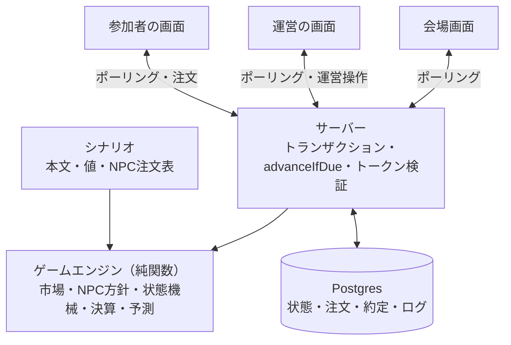
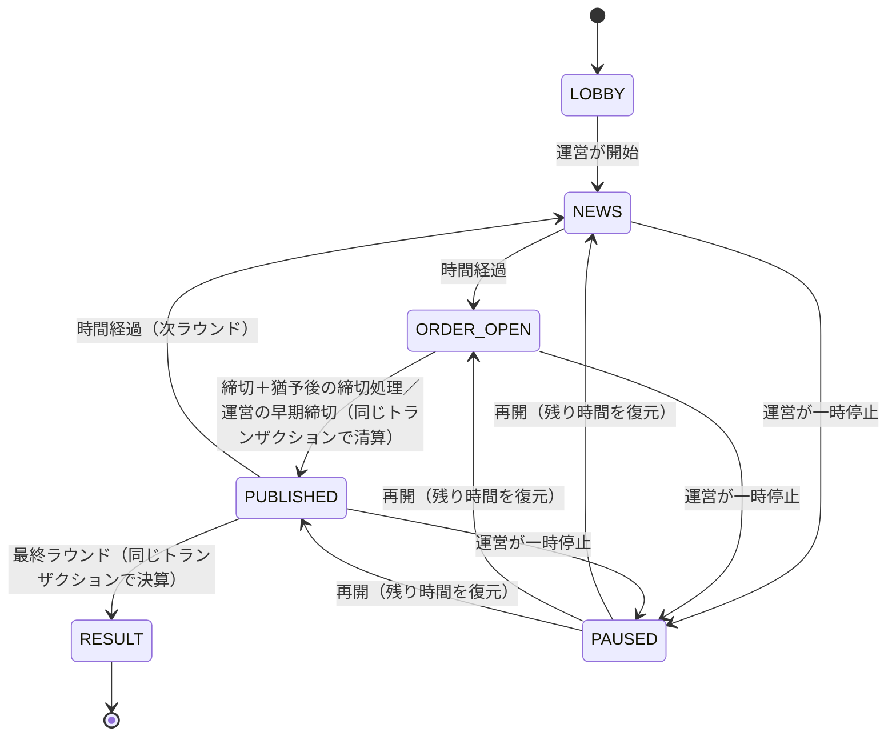

# Architecture

最終更新：2026-10-29
状態：**Proposed**（D-027。技術構成はオーナー承認前）

## 1. 目的

提案会議MVPから、銀行イベント、一人用の追加シナリオ、学校版まで、同じアプリとゲームエンジンで広げるための境界と構成を定めます（D-024）。市場の規則は`MARKET_SPEC.md`、提案会議MVPの範囲は`MEETING_MVP_SPEC.md`にあります。

## 2. アーキテクチャ原則

1. ゲームルールとシナリオコンテンツを分離する
2. ライブ進行（自動・手動）と一人用の自動進行を、同じ状態機械で扱う
3. 市場参加人数が1人でも成立させる
4. 注文、残高、価格、状態、精算はサーバー側で確定する
5. 重要操作を冪等にし、再送と再接続へ耐える
6. 全市場イベントを時系列で再生できるようにする
7. 実行時生成AIをイベントの事実生成に使わない
8. 個人情報を最小化し、計測用IDと本人情報を分離する
9. 運営者の手動制御と緊急停止を第一級機能にする
10. 外部サービスは交換可能な境界の後ろに置く
11. 清算の結果を、注文の到着順やブラウザの時計に依存させない

## 3. 論理構成



## 4. 共通ゲームエンジン

### 4.1 エンジンの関数

DB、HTTP、時刻、乱数の取得に依存しない純関数です。時刻と乱数のシードは引数で受け取ります。

```ts
// apps/web/src/engine
createMatch(scenario, { teams, k }): MatchState
phaseAfter(state, trigger, nowMs): Transition               // 状態機械
reserveFor(market, guildId, side, qty, rules): number
validateOrder(account, openOrders, intent, rules): Ok | Rejection
clearRound({ market, orders, algorithmVersion }): ClearingResult  // 価格、約定、台帳差分、統計、ハッシュ
settle(accounts, outcome, payout): SettlementResult
deriveForecast(positions, cash): Forecast                   // D-021
generateNpcSheet(scenario, seed): NpcSheet                  // 開発時だけ使う
```

NPCの方針は差し替え可能な部品にします。最初の実装は、固定の注文表を読むだけです（D-026）。

### 4.2 シナリオ

保持するもの：

- タイトル、世界観、ギルド、表示順
- 初期価格（初期のq）
- ラウンド、ニュース、補足情報、各フェーズの時間
- 調査券の窓、調査先と調査結果
- NPC商会の定義と、生成・レビュー済みの注文表とそのハッシュ
- 最終結果

保持しないもの：

- プレイヤーの残高と保有
- 注文処理と清算のロジック
- 認証・権限
- UIだけの一時状態

### 4.3 遊び方ごとの使い方

- **ライブ（提案会議、銀行イベント）：** サーバーがDBから状態を読み、エンジンを呼び、結果を1つのトランザクションで書きます。
- **一人版（オンライン）：** 同じエンジンを、参加者1商会・自動進行の試合として動かします。
- **一人版（オフライン）：** エンジンとシナリオはブラウザだけで動くため、将来は静的ページにまとめられます（別のADRで判断）。
- **長時間の一人版（毎時更新など）：** 期限を1時間にして、定期実行が`advanceIfDue`を呼ぶだけです。新しい進行の仕組みは要りません。
- **各自が独立した市場で競うランキング：** 試合をプレイヤーごとに作れば成り立ちます（将来）。

## 5. 状態機械と進行



- 注文は`ORDER_OPEN`のときだけ受け付けます。
- 清算は締切処理のトランザクションの中で完結します（計算は数ミリ秒）。「締切済み」「清算中」を永続状態にしないので、失敗すればロールバックされ、次の締切処理で再試行するだけです。50組規模やNPCの計算が重くなった段階で、2段階に分けます。
- 締切の判定には、ロック取得後のDBの`clock_timestamp()`を使います。ブラウザのタイマーは表示専用です。
- 猶予は1秒です。締切＋1秒までに届いた注文は受け付け、締切処理は締切＋1秒以降にだけ清算します。
- 一時停止中は予約の新規・変更を受け付けません。既存の予約は保持し、再開時に残り時間から続けます。確定した清算は巻き戻しません。補正が必要なら、補正の取引として記録します。
- 手動モードでは期限で自動進行せず、運営の「次へ」だけで進みます（銀行イベントの司会進行向け）。提案会議MVPの既定は自動進行です。
- 練習、ブリーフィング、デブリーフなどイベント版の段階は、この状態機械の上に表示の段階として載せます。詳細はイベントMVPの着手時に決めます。
- すべての遷移と運営操作を`match_events`に記録します（誰が、いつ、何を）。

## 6. 同期

- 正はDBです。状態が変わるたびに`matches.version`を1増やします。
- クライアントは`GET /state?since=v`を、注文受付中と締切の前後は1秒ごと、それ以外は3秒ごとに呼びます。非表示のタブでは止め、表示に戻った瞬間に取得します。変化がなければ空の応答を返します。
- **公開の同時性：** 清算時に`reveal_at = 清算時刻＋2秒`を保存します。各端末は応答に含まれる`serverNow`で時計のずれを補正し、`reveal_at`の瞬間に一斉に新価格を表示します。ポーリング間隔（1秒）が待ち時間（2秒）より短いので、全端末が間に合います。
- **締切処理を起動する役：** 運営画面と会場画面は、締切に達したら締切処理を送ります（進むまで2秒ごとに再送）。参加端末も、締切を過ぎた状態を受け取ったら送ります。誰が送っても1回しか処理されません。
- WebSocketはiOS Safariの画面ロックやバックグラウンドで切れるため、どのみち復帰時の再取得が必要です。そのため、最初はポーリングだけで作ります。
- 6〜8端末が1秒に1回取得しても、VercelとPostgresには軽い負荷です。50組でも、索引つきの1行読みが毎秒50回です。必要になれば、Supabase Realtime Broadcastを「起床通知」としてあとから足せます。

## 7. 構成と依存

```text
apps/web/                         # 独立したnpmプロジェクト。リポジトリのルートには依存を置かない
  package.json                    # Node 24、npm（kabu-leagueに合わせる）
  vercel.json                     # regions: ["hnd1"]
  compose.yaml                    # ローカルのPostgres 17
  prisma/schema.prisma, migrations/
  src/engine/                     # 純関数。next、react、prisma、node:* の読み込みをESLintで禁止
  src/scenarios/s01/              # 第1シナリオの定義、npc-sheet.json、内容ハッシュ
  src/server/                     # トランザクション、advanceIfDue、トークン検証
  src/app/m/[code]/               # 参加者
  src/app/host/[id]/              # 運営
  src/app/screen/[id]/            # 会場画面
  src/app/api/                    # Route Handlers
  scripts/                        # simulate.ts、generate-npc-sheet.ts、create-match.ts
  tests/                          # engine、db、e2e
.tool-versions                    # nodejs 24（asdf。P1で追加）
```

| 依存 | 目的 | 費用 | 出口 |
| --- | --- | --- | --- |
| Next.js 16、React 19、TypeScript 5 | 画面とAPIを1つのアプリにする（kabu-leagueと同じ） | 0 | 通常のNodeサーバーとして動かせる |
| Prisma 7＋`@prisma/adapter-pg` | スキーマ、移行、トランザクション（kabu-leagueと同じ） | 0 | SQLの移行ファイルに置き換えられる |
| zod | APIの入力検証 | 0 | 手書きの検証に置き換えられる |
| Tailwind CSS 4 | スマートフォン向けの画面（kabu-leagueと同じ） | 0 | 通常のCSSに置き換えられる |
| Vitest、tsx | エンジンとDBのテスト、スクリプトの実行 | 0 | — |
| Playwright | 複数端末のE2E | 0 | — |
| Docker（Postgres 17） | ローカル開発 | 0 | — |
| Supabase（Postgresのみ、東京） | 本番DB | Freeは7日間アクセスがないと停止する。Proは月25ドル〜（契約前に確認。既存の組織を流用できる可能性あり） | `pg_dump`で他のPostgresへ移せる |
| Vercel（hnd1） | ホスティング | Hobbyは非商用に限られる。Proは1人月20ドル〜（契約前に確認。既存のチームを流用できる可能性あり） | Nodeが動く環境ならどこでも動く |

- SupabaseはPostgresとしてだけ使い、RealtimeやAuthに依存しません。そのため、ほかのPostgresへ移しやすい構成です。
- Vercelの既定リージョン（米国東部）では、Supabase東京との往復が1クエリ150ms前後かかり、注文1件のトランザクションが1秒を超えかねません。kabu-leagueと同じく`hnd1`に固定します。
- 定期実行（Cron）は使いません。進行は`advanceIfDue`という1つの関数に集め、誰が何回呼んでも冪等にします。Cronは長時間の一人版で、この関数を呼ぶ役として足すだけです。
- CIは追加しません（必要になれば別途判断します）。

## 8. データモデル

```text
matches(id, join_code, scenario_id, scenario_hash, algorithm_version, k_scale,
        phase, round_seq, phase_ends_at, paused_remaining_ms, reveal_at, version,
        host_token_hash, created_at, settled_at)
teams(id, match_id, nickname, token_hash, joined_at)                    UNIQUE(match_id, nickname)
accounts(id, match_id, kind[player|npc|mm], team_id, npc_key, cash)      CHECK(kind='mm' OR cash >= 0)
positions(account_id, guild_id, qty, cost_basis)                        PK(account_id, guild_id)
orders(id, match_id, round_seq, account_id, guild_id, side, qty, reserve_cash, revision, status, updated_at)
                                                                        UNIQUE(match_id, round_seq, account_id, guild_id)
round_clearings(match_id, round_seq, q_after, prices, stats, input_hash, output_hash, created_at)
                                                                        PK(match_id, round_seq)
fills(id, match_id, round_seq, account_id, guild_id, side, requested, filled, price, cash_delta, reason)
investigations(match_id, team_id, round_seq, source)                    UNIQUE(match_id, team_id)
match_events(id, match_id, type, actor, public_payload, created_at)     -- 監査とリプレイ
```

- 金額と口数は整数だけです。小数は保存しません。
- CHECK制約で負の残高と負の保有を拒否します（市場係を除く）。
- NPCの注文はシナリオの注文表から読みます。清算の入力ハッシュには注文表も含めます。NPCの約定は`fills`に保存します（100商会×5ラウンドで最大500行）。
- 取得原価（`cost_basis`）は現在保有分のコストです。売却時は売却口数に対応する平均原価を減らします（D-021）。
- 予測スナップショット（D-021）は`fills`と`positions`から再計算できます。表示用に`round_clearings.stats`へ持ちます。
- 個人情報は商会名だけです。トークンはハッシュだけを保存します。

## 9. APIとトランザクション

| メソッド | パス | 呼ぶ人 | 内容 |
| --- | --- | --- | --- |
| POST | `/api/join` | 参加者 | `{code, nickname}`。httpOnly cookieを発行 |
| GET | `/api/m/:id/state?since=` | 全員 | 公開状態と本人の資産・予約。変化がなければ空 |
| PUT | `/api/m/:id/r/:seq/orders/:guildId` | 参加者 | `{side, qty, baseRevision}`。枠単位で冪等 |
| DELETE | 同上 | 参加者 | 予約の取消 |
| POST | `/api/m/:id/investigate` | 参加者 | `{source}`。1試合で1回 |
| POST | `/api/m/:id/tick` | 誰でも | `advanceIfDue`。期限前なら何もしない |
| POST | `/api/m/:id/host/:action` | 運営 | start、pause、resume、extend、close-now、next、abort |
| GET | `/api/m/:id/screen` | 会場画面 | 公開情報だけ |
| GET | `/api/m/:id/replay` | 全員 | 決算後だけ |

試合の作成は`scripts/create-match.ts`（CLI）で行い、管理画面は作りません。

```text
注文（PUT）
BEGIN
  SELECT … FROM matches WHERE id = $1 FOR SHARE        -- 締切処理（FOR UPDATE）と直列化
  phase = ORDER_OPEN、round_seq一致、clock_timestamp() < phase_ends_at + 1秒 を確認
  SELECT … FROM accounts WHERE id = $2 FOR UPDATE      -- 同じ商会の同時注文を直列化
  自由現金 = cash − 他の枠の予約合計、自由保有 = qty − 他の売り予約
  検証 → orders を upsert（revision + 1）
COMMIT

締切処理（tick）
BEGIN
  SELECT … FROM matches WHERE id = $1 FOR UPDATE
  期限前、一時停止中、処理済みなら何もせずCOMMIT
  ORDER_OPENなら：予約とNPC注文表で clearRound() → fills、positions、accounts、round_clearings を書き、
                   phase = PUBLISHED、reveal_at、version + 1
  最終ラウンドのPUBLISHEDなら：settle() → settled_at を記録
COMMIT
```

## 10. 認証・セキュリティ・プライバシー

- **参加：** 参加コード（6桁）と商会名で参加します。サーバーは32バイトの乱数トークンを発行し、httpOnly・Secure・SameSite=Laxのcookieに入れます。DBにはSHA-256のハッシュだけを保存します。開始後の参加は運営が許可した場合だけで、提案会議MVPの定員は12商会です。
- **運営：** 試合の作成時に別の32バイトの乱数トークンを発行し、運営画面のURLの`#`以降に入れます（サーバーのログや参照元に残りません）。参加コードから運営権限には届きません。これは提案会議MVPだけの暫定措置です。イベントMVPでは、Supabase Authなどで改めて判断します（O-007）。
- 書き込み系のAPIでは独自ヘッダーとJSONを必須にします（CSRF対策）。注文の持ち主はトークンから決め、URLのIDを信用しません。
- 他の商会の予約や保有は誰にも返しません。会場画面に出すのは、価格、人数の集計、順位（商会名と総資産）だけです。
- DBの接続情報はサーバーの環境変数にだけ置き、ブラウザにSupabaseのキーを渡しません。SupabaseのData APIはpublicスキーマを外部に公開するため、全テーブルでRLSを有効にし、ポリシーは置きません（全拒否）。
- アプリのログにトークンや商会名を出しません。提案会議の試合データは、会議の30日後にスクリプトで削除します。
- 提案会議MVPでは児童のデータを扱いません。イベントで使う前に、データ管理責任と保持期間を決めます（O-008）。

## 11. 監視と障害対応

- 監視はVercelのログと、運営画面の「接続中の端末数・最後に状態を取得した時刻」だけにします。外部の監視サービスは入れません。
- 当日の障害対応は`MEETING_MVP_SPEC.md` §9にあります。

## 12. 銀行イベント（30〜50組）へ広げるとき

- 50組相当の負荷試験を行い、ポーリングだけで足りるかを確かめます。足りなければRealtime Broadcastを起床通知として足します。
- 清算が重くなったら、「締切済み」「清算中」を永続状態に分けます。
- 運営者の認証（O-007）、手動進行、補正の取引、緊急停止を整えます。
- 参加組数に合わせてkを選びます（`MARKET_SPEC.md` §5）。
- 計測イベントは`DATA_AND_EVALUATION.md`に合わせて追加します。

## 13. 未決定の技術事項

- 50組規模でのRealtimeの要否
- 運営者の認証（O-007）
- データの保持期間と削除の責任（O-008）
- イベント版の計測・分析基盤、エラー追跡
- シナリオの正式なスキーマ（P1で決める）
- オフラインの一人版を静的ページにするか
- CI/CD
