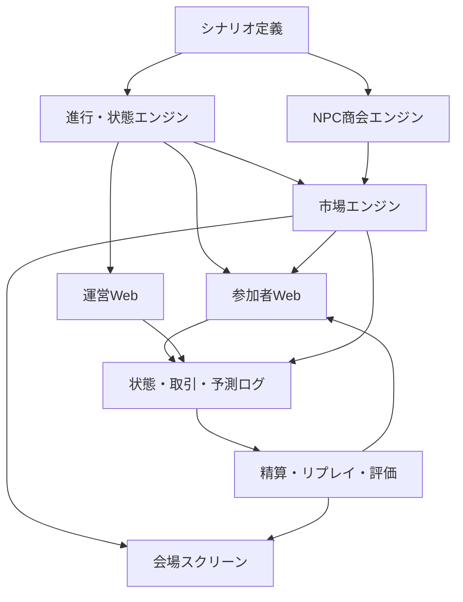

# Architecture

最終更新：2026-09-02
状態：技術スタック選定前の論理設計

## 1. 目的

提案用プロトタイプを短期間で作りながら、銀行イベント、一人用追加シナリオ、学校版へ発展できる境界を定義します。この文書は特定フレームワークやクラウドを決定しません。

## 2. アーキテクチャ原則

1. ゲームルールとシナリオコンテンツを分離する
2. ライブ手動進行と一人用自動進行を、同じ状態機械で扱う
3. 市場参加人数が1人でも成立させる
4. 本番では注文、残高、価格、状態、精算をサーバー側で確定する
5. 重要操作を冪等にし、再送と再接続へ耐える
6. 全市場イベントを時系列で再生できるようにする
7. 実行時生成AIを初期イベントの事実生成に使わない
8. 個人情報を最小化し、計測用IDと本人情報を分離する
9. 運営者の手動制御と緊急停止を第一級機能にする
10. 外部サービスは交換可能な境界の後ろに置く

## 3. 論理構成



## 4. 境界

### シナリオ定義

保持するもの：

- タイトル、世界観、ギルド
- 初期価格または初期市場状態
- ラウンド、ニュース、役割別情報
- 調査先と調査結果
- NPC商会の行動タイムライン
- 最終結果
- 進行時間の既定値

保持しないもの：

- プレイヤー残高
- 注文処理ロジック
- 認証・権限
- UIだけの一時状態

### 進行・状態エンジン

- 現在ラウンドと状態を管理する
- 許可された状態遷移のみ受け付ける
- ライブでは運営操作、自動モードではタイマー／プレイヤー操作を入力とする
- 再読み込みしたクライアントへ現在状態を返す

### 市場エンジン

- 注文見積もり
- 注文検証
- 約定
- 価格更新
- 保有・現金更新
- 市場開始／停止の強制
- 取引イベント出力

価格方式は交換可能なインターフェースにし、簡易デモ方式と本番方式を混同しません。

### NPC商会エンジン

- 一人版で他商会の動きを作る
- シナリオでレビューできる決定的または再現可能なルールを使う
- NPC注文であることをログに残す
- 実在プレイヤーとして偽装しない

### 精算・リプレイ・評価

- 固定結果に基づく精算
- 再実行しても二重加算しない
- 価格、ニュース、注文、予測を同一タイムラインで再生する
- 表彰・教育指標の元データを算出する

## 5. イベント状態モデル

上位状態：

```text
LOBBY
TUTORIAL
BRIEFING
FORECAST
MARKET_OPEN
MARKET_FROZEN
NEWS
SETTLEMENT
REPLAY
RESULT
```

遷移規則：

- `MARKET_OPEN`以外では注文を受け付けない
- `SETTLEMENT`は市場凍結後のみ実行できる
- `SETTLEMENT`後に取引状態へ戻さない
- `RESULT`は精算済みイベントのみ表示する
- ライブモードでは運営者のみが遷移を確定する
- 自動モードでは同じ遷移を自動進行器が要求する
- すべての遷移を時刻、実行者、遷移元、遷移先とともに記録する

状態遷移の正式図と例外処理は実装前に確定します。

## 6. 市場の論点

### LMSRを候補とする理由

- 注文相手がいなくても売買できる
- 4択の価格を確率のように表現しやすい
- 流動性パラメータで価格感応度を調整できる

### 実装前に決めること

- 表示価格と実際の購入費用の関係
- 子どもに分かる注文UI
- 数量指定か金額指定か
- 1注文と1チームの上限
- 流動性パラメータ
- 価格の丸め方
- 手数料の有無
- 売却可能量
- 取消時の再計算
- 運営補正が市場へ与える影響

「合計100G」はUI上の丸めによってずれる可能性があります。正確な内部値と表示値を分けて設計します。

## 7. 注文の安全性

本番注文は概念的に次を満たします。

1. クライアントが一意な注文IDを生成または取得する
2. サーバーがイベント、チーム、市場状態を確認する
3. サーバーが残高・保有・制限を確認する
4. サーバーが現在市場状態から見積もりを再計算する
5. 1つの原子的処理として約定と残高更新を記録する
6. 同じ注文IDの再送には同じ結果を返す
7. 約定イベントを配信する

クライアント表示だけで注文可否や残高を確定しません。

## 8. リアルタイム設計

本番では、全端末が毎秒DBへ書き込む必要はありません。

- 書き込み：注文、予測、調査、運営操作などのイベント発生時
- 配信：価格、状態、ニュース、残り時間の基準値
- カウントダウン：開始時刻と終了時刻を受け取り、端末側で描画
- 定期整合：再接続時と重要状態遷移時にスナップショットを取得

具体的な通信方式は技術選定時に決定します。

## 9. プロトタイプと本番の差

| 項目 | 提案用プロトタイプ | イベントMVP |
| --- | --- | --- |
| 状態 | ブラウザ内 | サーバーを正とする |
| 市場 | 簡易計算 | 正式アルゴリズム |
| NPC | 固定タイムライン | イベント版・一人版とも固定タイムライン（D-019） |
| 認証 | なし | 参加復帰・運営権限あり |
| ログ | 任意／ブラウザ内 | 監査・リプレイ可能 |
| 同期 | なし | 参加・運営・会場を同期 |
| 可用性 | デモ中に動けばよい | 切断復帰・緊急停止が必要 |

プロトタイプのコードを本番へそのまま昇格させることは前提にしません。ただし、シナリオ構造、状態名、UIで得た知見は再利用します。

## 10. コンテンツ例

以下は概念例であり、正式スキーマではありません。

```yaml
round: 3
title: ドラゴン輸送で重大事故
state_on_publish: MARKET_FROZEN
audience:
  child:
    text: 街では事故映像が急速に拡散している
    image: dragon-rumor.webp
  parent:
    text: 映像には会社名や製品番号が映っていない
investigation:
  newspaper: 目撃者への取材記事
  official: ギルドの製品一覧
  ai_report: SNS投稿を分析した速報レポート
trading_seconds: 90
```

## 11. 技術選定の評価軸

- 1日プロトタイプを速く作れる
- モバイルWebを作りやすい
- 50チーム同時利用を安定運用できる
- リアルタイム配信と原子的注文処理を両立できる
- ローカル開発とテストが再現可能
- ロックインを把握し、データを移行できる
- 小規模時の固定費が低い
- ログ、監視、バックアップを設定できる
- Codex、Claude Code、人間が理解しやすい
- 日本国内イベントでの運用とサポートが現実的

## 12. 未決定の技術事項

- フロントエンドフレームワーク
- 言語とランタイム
- API方式
- リアルタイム通信方式
- DBとホスティング
- 認証／匿名参加方式
- 監視、分析、エラー追跡
- テストフレームワーク
- CI/CD
- シナリオの正式スキーマ
- LMSR実装方式

技術選定は提案用プロトタイプ実装を開始する直前に、最小限のADRとして`DECISIONS.md`へ記録します。
