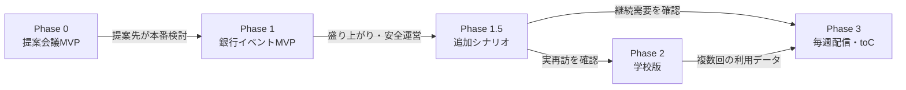

# Roadmap

最終更新：2026-10-29

日付は正式なイベント開催日と銀行側の意思決定によって変わります。ここでは、順序、成果物、次へ進む条件を正本とします。

2026-10-29に、GUILD MARKETを人工市場・一斉約定のゲームとして作り直す方針を決めました（D-024）。Phase 0の提案会議MVPから先は、同じアプリとゲームエンジンを広げていきます。

## 全体像

## Phase 0：提案会議MVP（人工市場のライブ対戦）

### 目的

銀行への提案会議で、5〜6人が各自のスマートフォンから同じ人工市場に参加し、約5分の対戦を体験します。詳細は`MEETING_MVP_SPEC.md`です。

### 成果物

- 新方式に合わせたプロジェクト文書一式
- 共通ゲームエンジン（市場、NPC、状態機械、決算、予測の導出）とシミュレータ
- 第1シナリオの会議用5ラウンド版と、レビュー済みのNPC注文表
- 参加者、運営、会場の画面
- 本番環境（Supabase東京、Vercel hnd1。費用は別途承認）
- 当日の手順書と、リハーサルの録画
- 銀行提案用の一枚概要とデモ台本
- 体験後の質問票

### 技術範囲

- `ARCHITECTURE.md`の構成（D-027）
- 30〜50組規模の負荷対策、正式な運営者認証、計測基盤は含まない
- 本番イラストは必須にしない

### 完了ゲート

- `MEETING_MVP_SPEC.md` §7の受け入れ条件を満たす
- 初見の参加者が、何をするゲームか一言で説明できる
- 噂による暴落と一次情報による反転、一斉公開の瞬間が伝わる
- 銀行または協力候補が本番検討へ進む

## Phase 1：銀行イベントMVP

### 目的

小学4〜6年生と保護者30〜50組の90分イベントを、安全かつ盛り上がる形で実施します。

### 想定期間

正式着手から8週間を基本とし、可能なら10週間確保します。Phase 0のアプリとエンジンを土台にするため、短縮できる可能性があります。

| 週 | 内容 |
| --- | --- |
| 1 | 提案会議の結果を反映したルール確定、台本骨子、既存ゲスっち調査 |
| 2 | 子ども向けの注文UXテスト（予約と一斉約定の理解）、50組規模の市場シミュレーション（kの決定） |
| 3〜4 | 練習・ブリーフィング・手動進行、親子向けの画面、注文ログと計測 |
| 5 | 運営画面の補正・緊急停止、運営者の認証、再接続、50組規模の同期 |
| 6 | シナリオ投入、精算、表彰、リプレイ |
| 7 | 親子10組、次に20組でプレイテスト |
| 8 | 負荷試験、修正、運営リハーサル、本番準備 |
| 9〜10 | 安全余白、追加テスト、会場固有調整 |

### 成果物

- 参加者Web
- 運営Web
- 会場スクリーン
- 4択市場（人工市場・一斉約定）
- 状態進行と同期（50組規模）
- シナリオコンテンツ
- 精算、表彰、市場リプレイ
- 計測とアンケート
- 運営台本、障害対応手順
- 負荷試験とリハーサル結果

### 完了ゲート

- 50チーム相当のテストを通過
- 締切後の予約、重複注文、残高不足を拒否
- 切断後に正しい状態へ復帰
- 緊急停止と手動進行をリハーサル
- KPIを計測可能
- 本番を中断せず完了

## Phase 1.5：一人用追加シナリオ

### 目的

「また遊びたい」という回答ではなく、イベント後に実際に遊ぶかを測ります。

### 成果物

- 10〜20分の追加シナリオ1本
- 自動進行（同じエンジンで、参加者1商会の試合として動かす）
- NPC商会（シードを変えた複数の注文表）
- イベント結果画面からのQR／リンク導線
- 開始、完了、主要判断の計測
- 個人向け市場リプレイ

### 初期シナリオ候補

錬金術ギルドの万能薬。「良い商品」と「事業としての成功」の違いを考えます。

### 完了ゲート

- イベント後7日以内の開始率を計測
- 一人＋NPCでも完走できる
- 完了率と離脱地点を把握できる
- 継続配信を希望する利用者が確認できる

## Phase 2：学校版

### 目的

学校へ無償提供し、普及、教員運用、複数回の教育データを検証します。

### 主な追加要件

- 45〜50分版
- 教員用進行ガイド
- クラス参加コード
- 2〜4人のチームプレイ
- 役割別情報カード
- 授業用振り返りシート
- 学校ネットワークへの耐性
- 個人アカウントなしでも利用可能

### 完了ゲート

- 金融の専門家でない教員が進行できる
- 授業時間内に完了する
- 複数校または複数クラスで再現できる
- 複数回プレイの行動変化を分析できる

## Phase 3：毎週配信・toC

### 目的

継続的なF-Sports体験として成立させます。

### 候補機能

- 毎週の短編シナリオ
- 予測者プロフィール
- 過去の自分との比較
- 家族・クラス・友人リーグ
- 結果カード共有
- ゲスっちとのプロフィール／ランキング連携
- シナリオ制作・レビュー運用

### ゲート

- 追加シナリオの実利用がある
- シナリオを継続制作できる
- 再訪の理由が特定できる
- インフラ、コンテンツ、サポート費用に対する収益仮説がある
- 児童向けサービスとして適切な安全設計ができる

## 今すぐやらないこと

- 承認前にクラウドや有料プランを契約する
- 毎週配信を先に約束する
- 個人課金を先に実装する
- ゲスっちと深く統合する
- 児童の恒久アカウントを必須にする
- 実在株価や実際の金融取引を扱う
- 実行時生成AIをゲーム進行へ入れる

## 直近の順序

1. 人工市場・一斉約定への切替（文書）と旧デモの削除（2026-10-29完了）
2. D-025〜D-027の承認（2026-10-29完了）と、提案会議の日程・人数の確認
3. エンジンとシミュレータ（P1）
4. サーバーとDB（P2）
5. 画面と、LAN上の実機5〜6台での内部テスト（P3）
6. 本番環境と4G回線でのリハーサル（P4）
7. 銀行向け提案資料とデモ台本
8. 銀行への提案会議（P5）

段階の詳細は`MEETING_MVP_SPEC.md` §11です。
